<div align="center">


# Holdfast

**Know which customers are about to leave, why, and what to do about it.**

A churn and retention copilot: it learns from your customer history, re-scores every account each
day, writes a plain-language brief with NVIDIA Nemotron, and measures whether your outreach
actually worked.

[](https://holdfast-ai.duckdns.org)
[](LICENSE)


[Live app](https://holdfast-ai.duckdns.org) · [Screenshots](#screenshots) ·
[Features](#features) · [Architecture](#architecture) · [Quick start](#quick-start) ·
[API](#api-reference) · [Deployment](#deployment)

</div>

---

## Overview

Holdfast helps customer-success and founding teams at subscription businesses keep the customers
they already have. Instead of guessing from a spreadsheet, the team connects billing (Razorpay,
Zoho Billing or Stripe) and optionally a CRM (Zoho CRM or HubSpot), or uploads a CSV/Excel export.

Holdfast then:

1. checks the data's quality and asks the team to **confirm what "churn" means**;
2. trains and fairly compares four model families, keeping a **reserved final test**;
3. **re-scores every account daily** and ranks who needs attention first;
4. has **NVIDIA Nemotron** write a short brief and a reason for each top account, with every
   number checked against the computed evidence before anyone sees it;
5. turns the ranking into **retention plays** that a person approves (CSV or CRM tasks);
6. keeps a random **holdout group** so the team can later see whether outreach measurably helped.

The repository is a pnpm/Turborepo monorepo: a React marketing site and workspace, a Better Auth
account service on Express and PostgreSQL, and a FastAPI service for data, machine learning, the
scheduler and the AI agent.

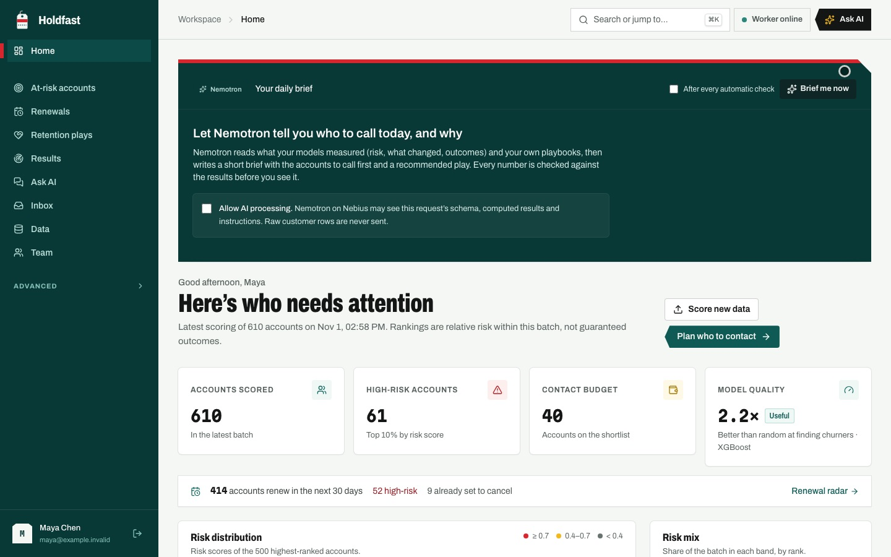

> Screenshots throughout this README show the running application with **synthetic demonstration
> data** (accounts such as `ACME-0757` are generated). No real customer appears anywhere.

## Contents

- [Features](#features)
- [Screenshots](#screenshots)
- [How it works](#how-it-works)
- [Nemotron and its guardrails](#nemotron-and-its-guardrails)
- [Data sources and connectors](#data-sources-and-connectors)
- [Roles and workspace access](#roles-and-workspace-access)
- [Architecture](#architecture)
- [Technology stack](#technology-stack)
- [Repository structure](#repository-structure)
- [Quick start](#quick-start)
- [Environment variables](#environment-variables)
- [Development and verification](#development-and-verification)
- [API reference](#api-reference)
- [Deployment](#deployment)
- [Honest boundaries](#honest-boundaries)
- [Contributing](#contributing)
- [License](#license)
- [Author](#author)

## Features

| Area                 | What you can do                                                                                                                                                                                            |
| -------------------- | ---------------------------------------------------------------------------------------------------------------------------------------------------------------------------------------------------------- |
| **Data in**          | Upload CSV/Excel (up to 200 MB / 1M rows), a multi-table bundle (accounts, invoices, usage, tickets), or connect billing and CRM systems. Quality is profiled before anything trains.                      |
| **Churn definition** | Confirm the target column and its "churned" value, or build point-in-time snapshots with a prediction horizon (for example "cancelled within 90 days"). Identifiers and post-outcome columns are excluded. |
| **Model comparison** | A baseline, Logistic Regression, Random Forest and XGBoost on the same reproducible split; the winner is chosen on validation data and evaluated once on a reserved test set.                              |
| **At-risk accounts** | Every current account ranked by risk score, with a triage band, Nemotron's checked reason, a contact budget and safe CSV export.                                                                           |
| **Renewal radar**    | Accounts renewing in the next 30/60/90 days, ranked by risk, with the value renewing and "set to cancel" flags straight from billing.                                                                      |
| **Daily checks**     | A scheduler re-syncs connected data, re-scores with the active model, measures drift (PSI), measures past predictions once outcomes are known, and proposes retraining for approval.                       |
| **Nemotron brief**   | A morning brief: what changed, who to call first and a recommended play, each claim verified before it is shown.                                                                                           |
| **Retention plays**  | Assign a play to the top of the contact list; it waits for approval, then becomes a CSV or tasks in Zoho CRM or HubSpot. Nothing is ever sent to customers.                                                |
| **Measured lift**    | A seeded random holdout of the contact list is never contacted; later, Holdfast compares churn between contacted and held-back accounts with a 95% bootstrap interval.                                     |
| **Ask AI**           | Questions about your results, answered from computed evidence with streaming responses, citations to your playbooks, and a visible trace of every tool call.                                               |
| **Teams**            | Personal and shared workspaces, owner/admin/member/viewer roles enforced on every request, an audit log, usage and privacy controls.                                                                       |
| **Inbox and email**  | A digest after every check in the Inbox, plus an optional per-person email digest through Resend.                                                                                                          |
| **Governance**       | Columns that must never reach the AI, data-retention periods, a daily token budget, an action quota and a kill switch.                                                                                     |

## Screenshots

|                                                                                                                      |                                                                                                                     |
| -------------------------------------------------------------------------------------------------------------------- | ------------------------------------------------------------------------------------------------------------------- |
| 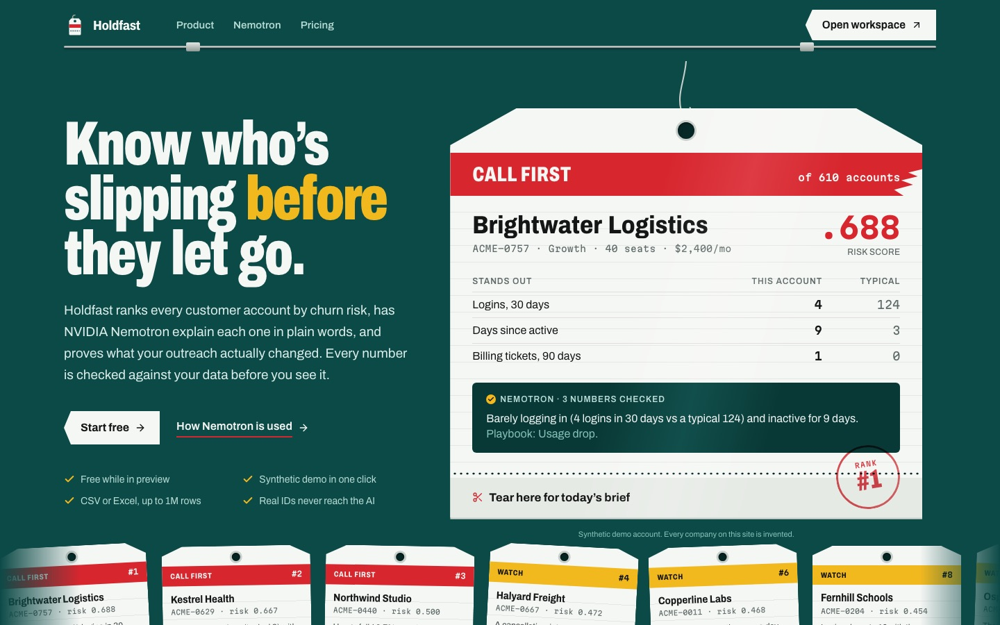 **Landing page:** the "triage board" marketing site.                   | 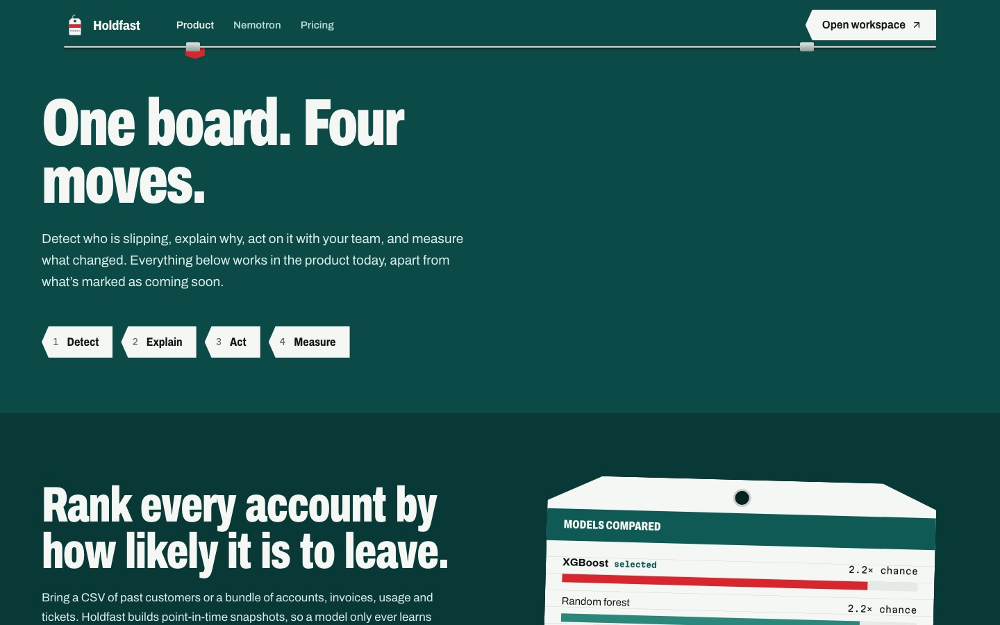 **Product page:** detect, act, measure.                               |
| 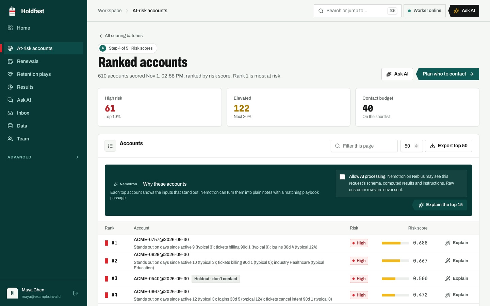 **At-risk accounts:** ranked, banded and explained.                | 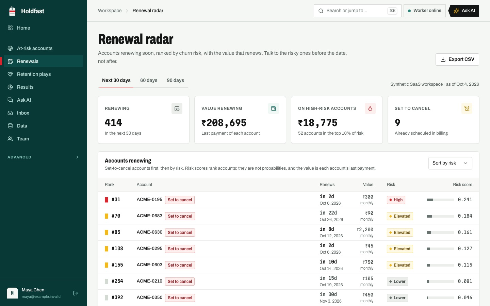 **Renewal radar:** who renews soon and might not.                   |
| 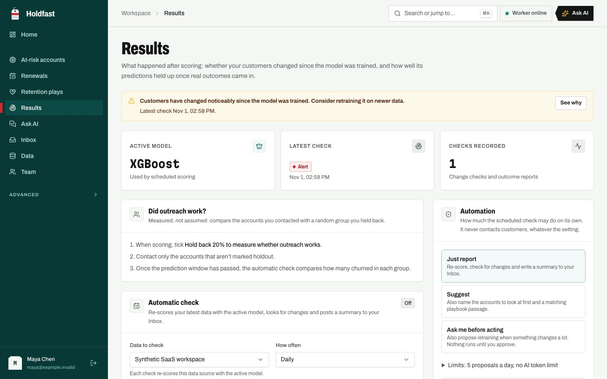 **Results:** active model, drift checks and automation.                     | 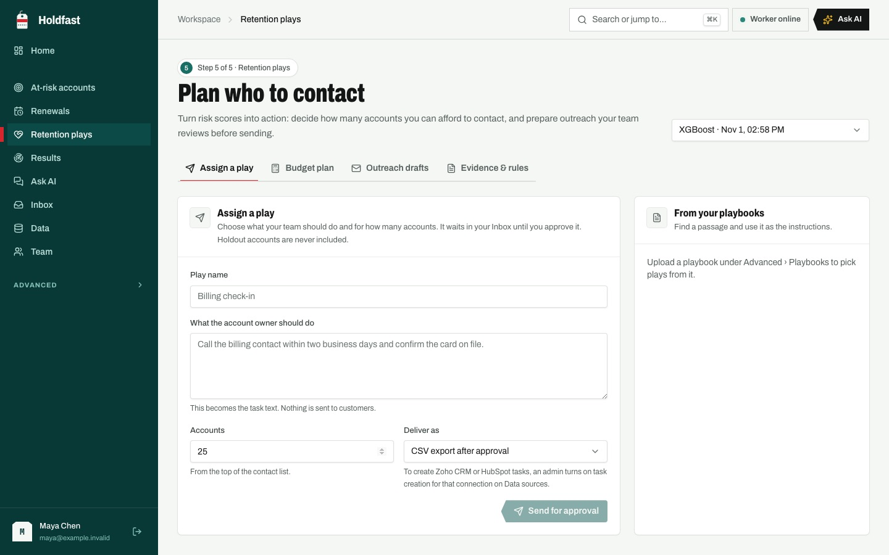 **Retention plays:** budgeted, approved, never auto-sent.            |
| 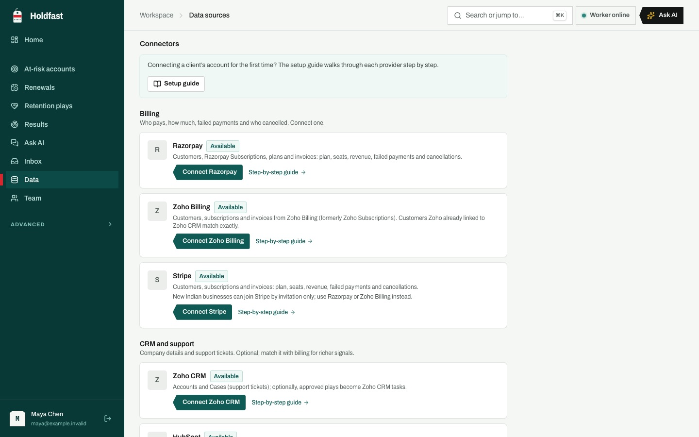 **Connectors:** Razorpay, Zoho Billing, Stripe, Zoho CRM and HubSpot. | 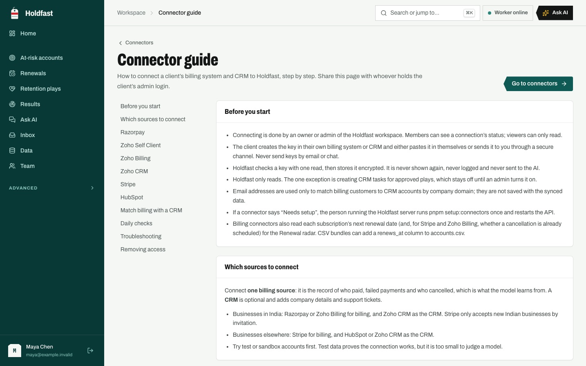 **Connector guide:** step-by-step setup for each provider. |

## How it works

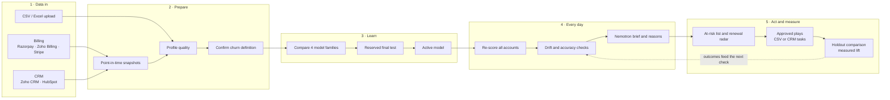

### The daily check

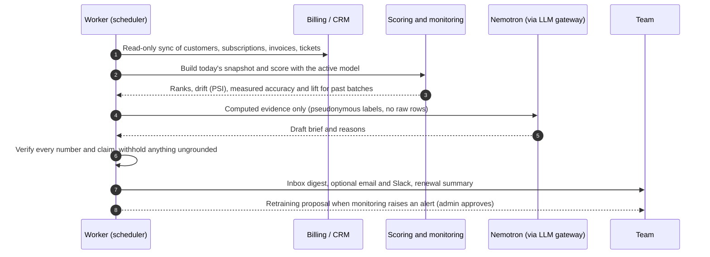

## Nemotron and its guardrails

Holdfast uses NVIDIA Nemotron (served by Nebius) to explain results in plain language. The model
never decides anything on its own:

| Guardrail                  | How it is enforced                                                                                                  |
| -------------------------- | ------------------------------------------------------------------------------------------------------------------- |
| **Grounded numbers**       | Every number in a brief, reason or answer must match the computed evidence; otherwise it is withheld and logged.    |
| **No causal claims**       | Wording that implies "X causes churn" is rejected; feature importance is reported as association.                   |
| **Pseudonymous inputs**    | The model sees labels like `A1`, never real account IDs or raw rows; admins can block columns entirely.             |
| **Bounded tools**          | The agent calls typed, workspace-scoped tools with call, time and token budgets. It cannot run code or touch files. |
| **People approve actions** | Plays, retraining and CRM writes wait in the Inbox for an owner or admin. Nothing is sent to customers.             |
| **Kill switch and budget** | A daily token budget, an action quota and a "pause all" switch per workspace.                                       |
| **Traced and evaluated**   | Every call is traced (spans, tokens, latency); versioned prompts and an offline eval harness guard regressions.     |

## Data sources and connectors

| Source           | Role    | What Holdfast reads                                                        | Write access                      |
| ---------------- | ------- | -------------------------------------------------------------------------- | --------------------------------- |
| **Razorpay**     | Billing | Customers, subscriptions, plans, invoices, renewal dates                   | None                              |
| **Zoho Billing** | Billing | Customers, subscriptions, invoices, renewal dates, scheduled cancellations | None                              |
| **Stripe**       | Billing | Customers, subscriptions, invoices, renewal dates, scheduled cancellations | None                              |
| **Zoho CRM**     | CRM     | Accounts, Cases (support tickets), a chosen churn date field               | Tasks for approved plays (opt-in) |
| **HubSpot**      | CRM     | Companies, tickets, a chosen churn date property                           | Tasks for approved plays (opt-in) |
| **CSV / Excel**  | Any     | A single customer table or a multi-table bundle                            | None                              |

Credentials are verified with one read and stored encrypted. Billing customers are matched to CRM
accounts by Zoho's own link or company email domain; domains are used in memory only. The in-app
**Connector guide** (`/app/guides/connectors`) walks clients through each provider step by step,
including the Zoho "Self Client" flow and Indian data-centre regions.

## Roles and workspace access

| Capability                                    | Owner / Admin | Member | Viewer |
| --------------------------------------------- | :-----------: | :----: | :----: |
| Read everything and ask AI questions          |      ✅       |   ✅   |   ✅   |
| Upload data, define churn, train and score    |      ✅       |   ✅   |   —    |
| Request Nemotron briefs and account reasons   |      ✅       |   ✅   |   —    |
| Assign plays and propose actions for approval |      ✅       |   ✅   |   —    |
| Approve or reject actions                     |      ✅       |   —    |   —    |
| Choose the active model                       |      ✅       |   —    |   —    |
| Connect and sync billing or CRM systems       |      ✅       |   —    |   —    |
| Change automation, privacy and retention      |      ✅       |   —    |   —    |
| Delete data                                   |      ✅       |   —    |   —    |
| Read the audit log                            |      ✅       |   —    |   —    |

Roles are enforced by the API on every request (`core/permissions.py`), not just hidden in the
interface. Every workspace keeps its own database and files.

## Architecture

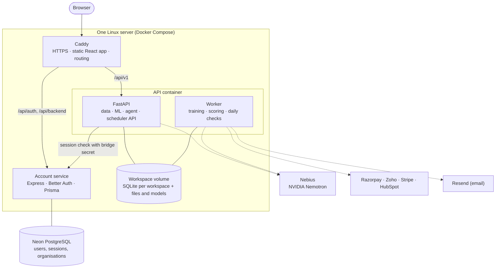

- **Auth bridge.** The Python API never reads the account database. It forwards the session
  cookie to the account service's internal identity endpoint, authenticated by a shared secret,
  and receives the user, organisation, role and email.
- **Jobs.** Training, scoring and checks are durable, idempotent jobs claimed by one supervised
  worker process with time limits, cancellation and restart recovery.
- **Agent.** Every model call goes through one LLM gateway (retries, routing, usage), is traced,
  and uses versioned prompt files.

## Technology stack

| Layer            | Technology                                                                            |
| ---------------- | ------------------------------------------------------------------------------------- |
| Web              | React 19, TypeScript, Vite, Tailwind CSS 4, TanStack Query, Zustand, Motion, Recharts |
| Accounts         | Node.js 22, Express 5, Better Auth 1.7 (organisations), Prisma, PostgreSQL on Neon    |
| API              | Python 3.13, FastAPI, Pydantic, SQLModel/SQLite per workspace                         |
| Machine learning | pandas, NumPy, scikit-learn, XGBoost, joblib                                          |
| AI               | NVIDIA Nemotron via Nebius (OpenAI-compatible SDK), LangGraph for investigations      |
| Integrations     | Razorpay, Zoho Billing, Zoho CRM, Stripe, HubSpot, Resend, Slack webhook              |
| Infrastructure   | Docker Compose, Caddy (automatic HTTPS), AWS Lightsail, pnpm, Turborepo, uv           |

## Repository structure

```text
customer-intelligence/
├── apps/
│   ├── web/                 React marketing site (src/pages) and workspace (src/workspace)
│   ├── backend/             Better Auth account service (Express, Prisma)
│   └── api/                 FastAPI service, package customer_intelligence
│       ├── src/customer_intelligence/
│       │   ├── api/routes/  thin HTTP routes
│       │   ├── services/    workflow, connectors, monitoring, briefs, renewals, email…
│       │   ├── ml/          splits, preprocessing, snapshots, evaluation, policy
│       │   ├── agent/       LLM gateway, tracing, prompts, tools, LangGraph investigation
│       │   ├── models/      SQLModel tables
│       │   └── worker/      job execution and scheduling
│       ├── tests/           pytest suites (fake providers, real CPU training)
│       └── evals/           recorded agent evaluations
├── deploy/                  Dockerfiles, docker-compose.yml, Caddyfile, backup script
├── docs/                    backend, workspace, auth, deploy and strategy notes
└── scripts/                 setup helpers (Python env, account backend, connectors)
```

## Quick start

**Requirements:** Node.js 22.12+, pnpm 11, Python 3.13 and (on macOS) `brew install libomp` for
XGBoost.

```sh
git clone https://github.com/itzzfalcon52/holdfast.git
cd holdfast
pnpm install
pnpm setup:python        # creates apps/api/.venv with a pinned uv
pnpm setup:backend       # writes apps/backend/.env secrets; add your Neon DATABASE_URL first
pnpm setup:connectors    # optional: encryption key for billing/CRM connectors
```

Add your Nebius key and model to `apps/api/.env` (see `apps/api/.env.example`). Upload, training
and scoring work without it; only the AI features need it.

```sh
pnpm dev                 # web :5173, account service :3001, API :8000
pnpm worker:api          # in a second terminal: required for training, scoring and checks
```

Open <http://127.0.0.1:5173>, create an account and choose **Run the demo** on Home. It loads
clearly labelled synthetic data, trains, scores and shows the whole workflow. Interactive API
docs are at <http://127.0.0.1:8000/docs>.

## Environment variables

| Variable                                                       | Where         | Purpose                                                    |
| -------------------------------------------------------------- | ------------- | ---------------------------------------------------------- |
| `DATABASE_URL`, `DIRECT_DATABASE_URL`                          | backend       | Neon PostgreSQL for accounts                               |
| `BETTER_AUTH_SECRET`                                           | backend       | Session signing secret                                     |
| `INTERNAL_API_SECRET`                                          | backend + API | Shared secret for the identity bridge                      |
| `APP_ORIGIN`                                                   | backend + API | The browser origin, e.g. `https://holdfast-ai.duckdns.org` |
| `NEBIUS_API_KEY`, `NEBIUS_BASE_URL`, `NEBIUS_MODEL`            | API           | Nemotron through Nebius                                    |
| `CI_CREDENTIALS_KEY`                                           | API           | Fernet key that encrypts connector credentials             |
| `CI_RESEND_API_KEY`, `CI_EMAIL_FROM`                           | API           | Optional email digests                                     |
| `CI_MAX_UPLOAD_MB`, `CI_MAX_ROWS`, `CI_WORKER_TIMEOUT_SECONDS` | API           | Upload and training limits                                 |

Secrets live only in server-side `.env` files. Nothing secret is ever exposed through `VITE_*`
variables, logs or exports.

## Development and verification

```sh
pnpm lint && pnpm check-types && pnpm build && pnpm format:check
pnpm test:api            # 162 pytest tests: fake providers, real CPU training and reloads
pnpm --filter @ci/web test
pnpm test:backend
pnpm eval:agent          # replays recorded agent evaluations offline (free)
```

Tests never call a live AI provider or real billing/CRM accounts: connectors run against fake
servers built from the synthetic generator, and the agent uses a mocked provider.

## API reference

The full, typed contract is served at `/docs` (OpenAPI). The main groups:

| Group              | Endpoints                                                                                                                  |
| ------------------ | -------------------------------------------------------------------------------------------------------------------------- |
| Data               | `POST /api/v1/datasets` · `GET /api/v1/datasets/{id}/profile` · `POST /api/v1/sources/{id}/datasets`                       |
| Churn and training | `POST /api/v1/datasets/{id}/tasks` · `POST /api/v1/jobs/train` · `GET /api/v1/runs/{id}`                                   |
| Scoring            | `POST /api/v1/jobs/score` · `GET /api/v1/scores/{id}/customers` · `GET /api/v1/renewals`                                   |
| Monitoring         | `GET/PUT /api/v1/schedule` · `POST /api/v1/schedule/run` · `GET /api/v1/monitoring/{id}` · `POST /api/v1/registry/promote` |
| AI                 | `POST /api/v1/briefs` · `POST /api/v1/assistant/messages/stream` · `GET /api/v1/assistant/traces`                          |
| Actions            | `POST /api/v1/actions/plays` · `POST /api/v1/actions/{id}/approve` · `GET /api/v1/digest`                                  |
| Connectors         | `GET/POST /api/v1/connections` · `POST /api/v1/connections/{id}/sync` · `PUT /api/v1/connections/{id}/settings`            |
| Governance         | `GET /api/v1/audit` · `GET/PUT /api/v1/privacy` · `GET/PUT /api/v1/autonomy` · `GET/PUT /api/v1/email/subscription`        |

See [docs/backend.md](docs/backend.md) for request examples, job semantics and limitations.

## Deployment

Holdfast runs on a single Linux server with Docker Compose: Caddy (automatic HTTPS and the static
app), the account service, and the API with its worker sharing one data volume. Accounts stay
in Neon.

```sh
cp deploy/.env.production.example deploy/.env   # fill in domain, database and secrets
docker compose -f deploy/docker-compose.yml --env-file deploy/.env up -d --build
docker compose -f deploy/docker-compose.yml --env-file deploy/.env run --rm backend \
  ./node_modules/.bin/prisma migrate deploy
```

The live instance runs on AWS Lightsail at
**[holdfast-ai.duckdns.org](https://holdfast-ai.duckdns.org)**. The full walkthrough (instance,
firewall, deploy key, backups and updates) is in [docs/deploy.md](docs/deploy.md).

## Honest boundaries

- **Risk scores are ranks, not probabilities**, unless a calibrated model is chosen; Holdfast never
  turns them into an "expected loss".
- **Feature importance is association, not causation.** A contact list does not prove an offer
  works; only the holdout comparison measures that, and it says "no clear difference yet" when that
  is the honest answer.
- **Budget and ROI figures are your assumptions**, not measured returns.
- **Connector field mappings** follow each provider's documentation and are verified against fake
  servers; the first live sync of a new provider should be checked.
- **One server, one worker.** Metadata lives in per-workspace SQLite; scaling out would move it to
  PostgreSQL and object storage.

## Contributing

1. Fork the repository and create a branch.
2. Keep business and ML logic in `services/` and `ml/`, independent of HTTP and the LLM.
3. Add a new prompt version instead of editing an existing one.
4. Don't edit `apps/api/src/customer_intelligence/ml/preprocessing.py`: saved pipelines
   fingerprint it.
5. Run the checks above and open a pull request describing what changed and how it was verified.

## License

Released under the [MIT License](LICENSE).

## Author

**Hussain Kagalwala**

- Live app: [holdfast-ai.duckdns.org](https://holdfast-ai.duckdns.org)
- GitHub: [@itzzfalcon52](https://github.com/itzzfalcon52)
- Other projects: [SponsCRM](https://github.com/itzzfalcon52/sponsCRM) · [sponscrm.tech](https://sponscrm.tech)
