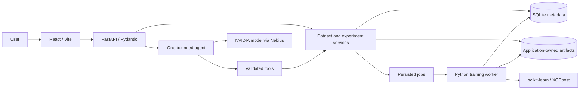

# Customer Intelligence — Product and Development Roadmap

Updated October 12, 2026. The P0/P1 backend and marketing frontend are implemented; account access, core product screens and P2 remain planned. Sections below describe product intent as well as future work; the current-state section and backend walkthrough are authoritative for shipped behavior.

## 1. What we are building

A customer retention copilot for small subscription businesses. A user uploads historical customer data, confirms what churn means, checks whether the data can support that goal, compares a few ML models, and scores a separate customer sheet. The product turns the results into a ranked contact list and explains the evidence through an agent.

**Core promise:** help someone answer “Which customers should I investigate or contact first, and how trustworthy is that recommendation?”

Example journey:

1. Upload a historical customer CSV containing features and a churn label.
2. Confirm the target column, positive label, customer ID, and columns available before churn.
3. Review missing values, class imbalance, potential identifiers, and possible leakage.
4. Run a bounded experiment comparing a baseline, Logistic Regression, Random Forest, and XGBoost.
5. Understand the selected model, validation metrics, and limitations.
6. Upload current customers with the same feature schema, without requiring churn labels.
7. Choose a contact budget, inspect a ranked list, and export it.
8. Ask the agent questions such as “Why was this model selected?” or “What changes if I can contact only 50 customers?”

This contains an AutoML component: automated preprocessing, training, and model comparison already exist. The proposed product value is the complete retention workflow: data readiness, evaluation appropriate to the data, visible evidence, and a usable contact shortlist. Treat these as design goals, not claims of unique technology or proven business impact.

A high risk score does not establish that an offer will prevent churn. Offer effectiveness requires intervention evidence, ideally a randomized retention experiment.

## 2. Current state and scope

### Implemented backend

The user authorized completing P0 and P1 backend features. Upload/profile/readiness/tasks,
train-only preprocessing, saved splits, four model families, bounded search, jobs/recovery/cancellation,
trusted pipeline persistence, frozen test evaluation, scoring/ranking/export, and agent context are
implemented. P1 includes XLSX import, leakage showcase, validation importance, customer sensitivity,
contact curves, numeric heuristics, value priority, evidence paths, HTML reports, calibration,
segments, conversations and run comparison. See [docs/backend.md](docs/backend.md) for runnable
requests and exact limits; [README.md](README.md) has startup/demo/check commands.

**Current constraints:** one private local workspace; binary classification on one static customer
table; stratified random evaluation; one supervised CPU worker on macOS/Linux. Calibration is
optional sigmoid calibration on development data. Customer explanations use reference perturbations,
not SHAP. Contact/segment curves are returned as JSON for frontend rendering. The assistant uses
one bounded SDK tool loop, not LangChain/LangGraph or vector retrieval. Tests mock the provider.

### Remaining product work

The React/Vite marketing pages are implemented, with disabled login/signup design previews. Account access remains planned. Upload/goal forms, plots, job progress/cancellation UI,
report/history screens and evidence navigation must be wired to the real backend. Public deployment,
real identity/tenancy, chronological/grouped evaluation and P2 integrations are not implemented.
Backend completion is not hackathon submission completion or proof of startup demand.

Start with `pnpm dev:api` plus `pnpm worker:api`, run `apps/api/demo.py`, then build the frontend
around that working journey. Preserve existing saved Telco data; use fresh synthetic demo records
when learning or checking final test behavior.

## 3. Priority rules

- **P0:** the end-to-end workflow needed for a credible working demo.
- **P1:** differentiation and usability improvements after P0 is reliable.
- **P2:** expansion beyond the first hackathon release.

Build a complete small workflow before widening the feature list. Each milestone must have visible output and a clear completion check. A failing dataset should produce a useful explanation, not a forced model recommendation.

## 4. Feature backlog

### P0 — First complete release

#### A. Dataset upload and preview

Accept a CSV, show a bounded preview, and assign a server-generated dataset ID. Store the original file under application-controlled storage; do not use the supplied filename as a path. Return clear errors for malformed files, duplicate headers, empty files, and unsupported encodings.

Proposed starting limits: 10 MB, 50,000 rows, and 250 columns. These are configurable product limits to validate against the demo machine, not measured capacity claims. Enforce file size while reading and parsing limits before expensive operations. Do not send a whole dataset to an LLM.

**Completion:** a valid CSV produces a preview and saved metadata; invalid uploads receive actionable errors; oversized uploads are rejected.

#### B. Dataset profile and readiness report

Compute row/column counts, column types, missing counts and percentages, duplicate-row counts, cardinality, numeric summaries, and target distribution. Flag potential IDs, date fields, constant columns, and high-cardinality text.

Separate hard blockers from warnings. Examples of blockers: missing target, unsupported target values, one-class target, no usable features, or insufficient class observations for the selected split. The minimum should depend on whether each evaluation partition can actually support the required metrics; avoid one universal row-count rule.

**Completion:** a user can see what is wrong and what they need to fix before training.

#### C. Goal and column confirmation

Collect a structured task specification: dataset ID, target column, positive label, ID column if available, included/excluded features, evaluation strategy, and deployment assumptions. Normalize labels explicitly, for example `Yes` → 1 and `No` → 0; preserve the mapping.

Ask which columns are known when making the prediction. Suggest suspicious fields such as cancellation date or termination reason, but require evidence or user clarification before treating an ambiguous field as proven leakage. Never let an LLM invent labels.

A prediction horizon such as “next 30 days” is supported only when the data contains appropriate observation dates and future outcomes. Otherwise describe the demo as classification of its supplied label.

**Completion:** users can inspect and edit the task specification, and training cannot bypass readiness blockers.

#### D. Reproducible evaluation and preprocessing

Create the split before learning transformations. Use a scikit-learn `Pipeline` and `ColumnTransformer`: numeric imputation, categorical imputation/encoding, and scaling where appropriate. Keep customer IDs for exports, outside the predictive feature matrix. Initially reject unsupported free-text and complex nested values rather than silently making unstable features.

Use stratified train/validation/test partitions for suitable static data; use chronological or group-aware partitions when the deployment scenario requires them. Save exact row assignments, random seed, feature schema, and dataset fingerprint.

**Completion:** all candidate models use the same evaluation rows, and the final saved pipeline can transform unseen but compatible rows.

#### E. Bounded model comparison

Start with a dummy baseline and Logistic Regression. Once that path works, add Random Forest and XGBoost. Run one conservative configuration per model before introducing parameter search. Store parameters, runtime, library versions, validation metrics, failures, and artifact IDs.

Select the primary metric before training. For imbalanced churn, average precision can be a starting choice; contact-budget metrics make the results easier to interpret. Do not select by accuracy alone. Keep failed models visible and allow partial success.

**Completion:** the leaderboard contains real stored results, identifies the selection metric, and reports when no model convincingly improves on the baseline.

#### F. Model selection and final report

Select the model and any decision threshold/contact policy on validation data. Freeze that choice before evaluating the held-out test set. Display validation and final test results separately.

Report average precision, precision/recall at a selected operating point, confusion matrix, and ROC-AUC where defined. Display class counts and explain undefined metrics. Include a plain-language account of the split, excluded fields, training budget, and limitations.

**Completion:** the recommendation references a run and measured metrics; repeatedly exploring the leaderboard does not retune against the final test set.

#### G. Batch scoring and contact shortlist

Upload a second sheet and validate its input schema against the selected pipeline. Missing required columns and incompatible types should be clear errors. Handle extra columns explicitly. Unseen categorical values should follow the saved encoder's documented behavior.

Generate a customer ID, risk score, and rank for each row. If no meaningful customer ID exists, use a labeled row reference rather than implying a durable business identifier. Keep ties deterministic. Describe outputs as model risk scores until calibration is checked.

Let the user choose a contact count `k` and export the full scores or top `k` list. Contact-list size is independent of a binary decision threshold. Protect text fields in spreadsheet-compatible exports against formula execution.

**Completion:** the same scoring file and model yield reproducible rankings, and exports include enough provenance to identify the model/run.

#### H. Agent that uses real tools

Add one bounded agent after the underlying services work through normal APIs. It can inspect data, explain warnings, propose an experiment plan, invoke allowed actions, retrieve job status, and explain stored results. The backend owns calculation, access control, and workflow state.

Use Pydantic-validated tool arguments, a tool allowlist, timeouts, and a small per-turn tool-call limit. Show visible actions such as “Inspecting labels” or “Retrieving model results.” Training follows a reviewed plan; an explicit user request to run an already agreed plan can authorize execution without another redundant confirmation.

**Completion:** answers reference real dataset/run IDs and tool outputs, and the agent cannot train on a blocked dataset or invent model scores.

#### I. Jobs, persistence, and recovery

Use SQLite/SQLModel metadata and application-owned files for the first local version. Training returns a job ID and runs in a separate bounded worker process. Start with one concurrent training job. Poll for job updates from React Query.

Persist `queued`, `running`, `succeeded`, `failed`, and `cancelled` states. Store timestamps, progress stage, errors, and result IDs. Define restart behavior: interrupted jobs must become failed or eligible for deliberate retry, not remain running forever. Make repeated submissions idempotent.

**Completion:** the API stays responsive during training, refresh preserves results, and a stopped worker produces a recoverable state.

#### J. Demo readiness and basic data controls

Provide a documented sample training/scoring pair with license or synthetic-data provenance. Include helpful loading, empty, and error states. Keep secrets on the backend, separate workspace data, validate resource ownership, and support dataset deletion with a documented artifact-retention policy.

A local single-user prototype can start with one explicit local workspace. Before public hosting, add a server-validated identity/session mechanism; client-provided workspace IDs alone are not authorization. Show a plain-language notice before transmitting dataset summaries to the model provider.

**Completion:** another person can follow the README, complete the supported workflow, and understand where their data goes.

### P1 — Improve differentiation and usability

| Feature                       | What to add                                                                              | Dependency / limit                                                        |
| ----------------------------- | ---------------------------------------------------------------------------------------- | ------------------------------------------------------------------------- |
| Excel import                  | Sheet selector, headers preview, explicit handling of dates and formulas                 | CSV upload must already work; read values without executing macros        |
| Leakage demonstration         | A documented synthetic post-outcome column and a validation-only with/without comparison | Keep the final test set out of exploratory comparisons                    |
| Global feature importance     | Permutation importance on validation data, with feature mapping                          | Explain associations and correlated-feature limitations                   |
| Per-customer explanation      | A small set of model attributions for selected records                                   | Investigate SHAP or another compatible method; not installed yet          |
| Contact-budget curve          | Precision@k, recall@k, and lift@k across list sizes                                      | Requires labeled validation data; scoring customers usually lack outcomes |
| Business heuristic comparison | Compare with a simple recency/activity rule                                              | Only when the data supports that rule                                     |
| Revenue-aware prioritization  | Optional value field alongside risk; explain the ranking formula                         | Exposure estimates are not proven saved revenue                           |
| Small parameter search        | A user-visible maximum trial/time budget                                                 | Tune only on training folds/validation; record every trial                |
| Evidence links in chat        | Open the profile, metric, warning, or run behind an answer                               | Stable resource IDs and UI navigation                                     |
| Exportable experiment report  | Download HTML report containing dataset version, plan, metrics, and exclusions           | Persistence and provenance first                                          |
| Cancellation and retry UI     | Cancel a worker job and retry failed jobs without duplicate runs                         | Worker must actually stop work and release resources                      |
| Calibration checks            | Reliability plots/Brier score and calibration using permitted development data           | Never fit calibration on the final test set                               |
| Segment comparisons           | Compare performance across sufficiently large customer segments                          | Report counts and uncertainty; avoid conclusions from tiny groups         |
| Saved conversations           | Restore messages, tool events, and workspace/run context                                 | Redact secrets and unnecessary customer content                           |
| Better run history            | Compare saved runs and explain why inputs/metrics differ                                 | Prevent comparisons that hide incompatible splits or tasks                |

### P2 — Later product expansion

| Feature                     | Purpose                                                   | Extra work needed                                                    |
| --------------------------- | --------------------------------------------------------- | -------------------------------------------------------------------- |
| Authentication and teams    | Shared, durable business workspaces                       | Identity, membership, authorization, audit events                    |
| CRM import/export           | Reduce manual spreadsheet work                            | Explicit scopes, schema mapping, duplicate handling                  |
| Outreach drafts             | Draft a message for a human to review                     | Approved business context and privacy controls                       |
| Outreach sending            | Execute an explicitly requested campaign                  | Confirmed recipients/content, service integration, delivery tracking |
| Retention experiments       | Measure which interventions help                          | Random assignment, consent/business process, outcome windows         |
| Drift monitoring            | Detect input changes over time                            | Saved reference distributions and limits                             |
| Performance monitoring      | Evaluate scores after real outcomes arrive                | Delayed-label collection and consistent cohorts                      |
| Retraining and rollback     | Replace a model with evidence                             | Versioned artifacts, comparable evaluation, deployment policy        |
| Multi-table/customer events | Build snapshot features from usage/payment/support tables | Join rules, timestamps, history windows, leakage controls            |
| Other prediction tasks      | Lead conversion, repeat purchase, customer value          | Separate labels, metrics, evaluation, and UI contracts               |
| Policy retrieval            | Ground suggested actions in approved company policies     | Versioned documents, retrieval evaluation, citations                 |
| Scheduled reports and voice | Improve access and recurring workflows                    | Scheduling, identity, cost controls, stable core product             |

P1 and P2 are options, not a checklist that must all ship. Skip voice, vector databases, multi-agent orchestration, fine-tuning, and GPU training in the first release unless a demonstrated requirement justifies them.

## 5. Data contract and ML integrity

### Historical training data

A simple supported sheet contains one row per customer, feature columns, an optional customer ID, and a binary target. Record the source, license, label definition, and whether the rows represent a static benchmark or actual dated snapshots.

For a real future-churn task, each row needs an observation date and features available by that date. The label represents an outcome over a completed future window. Customers whose outcome window has not finished are not automatically non-churners.

Chronological evaluation may require a gap between partitions to avoid overlapping outcome windows. Repeated customer snapshots also require a deliberate decision about whether deployment predicts for known customers or unseen customers. Grouping, time boundaries, and label windows must support that claim.

### Current scoring data

Require the saved input feature schema, but not the target. Validate types and missing fields before predicting. Preserve row order/IDs in outputs and avoid silently dropping customers. Do not evaluate performance on an unlabeled scoring file.

### Metric definitions

For a labeled evaluation set with `N` customers, `P` actual churners, and a top-`k` list containing `TP_k` churners:

- `precision@k = TP_k / k`
- `recall@k = TP_k / P`
- `prevalence = P / N`
- `lift@k = precision@k / prevalence`

Validate `1 <= k <= N`. If there are no positive cases, report the affected metric as undefined with a reason. Random selection has expected precision equal to prevalence, but a particular random list varies. Treat deployment contact budgets and validation contact budgets explicitly; a percentage of the population can be easier to compare across different dataset sizes.

The pipeline should protect against preprocessing leakage, but it cannot prove that every business feature was available before the outcome. Ask for domain context and record assumptions. Scikit-learn documents why preprocessing must be fitted on training data and how pipelines help enforce this [in its data-leakage guidance](https://scikit-learn.org/stable/common_pitfalls.html#data-leakage).

## 6. Architecture and library responsibilities



Backend components in the diagram are implemented. Web product screens and external/P2 integrations remain planned.

| Component                    | Responsibility                                           | Existing libraries                             |
| ---------------------------- | -------------------------------------------------------- | ---------------------------------------------- |
| React/Vite/TypeScript        | Forms, screens, route navigation, state presentation     | React, React Router                            |
| API client layer             | Requests, polling, cache invalidation, typed errors      | React Query, Zod                               |
| Charts and icons             | Model metrics, contact curves, visual cues               | Recharts, Lucide                               |
| FastAPI/Pydantic             | Validated API contracts, dependency wiring, typed errors | FastAPI, Pydantic, pydantic-settings           |
| Data services                | CSV/Excel parsing, deterministic profiles                | pandas, NumPy, openpyxl                        |
| ML package                   | Splits, pipelines, evaluation, scoring                   | scikit-learn, XGBoost, joblib                  |
| Persistence                  | Metadata and resource lookup                             | SQLModel with SQLite initially                 |
| Agent transport              | Calls to a configured compatible model endpoint          | OpenAI SDK, HTTPX                              |
| Optional agent orchestration | Tool abstractions or resumable state                     | LangChain, langchain-openai, LangGraph         |
| Developer checks             | Lint, types, focused tests, builds                       | Ruff, mypy, pytest, ESLint, TypeScript, Vitest |

The OpenAI SDK is a client library here; using it does not require selecting an OpenAI model. Configure a supported NVIDIA model through the chosen Nebius service. Verify the actual model ID, endpoint, tool-calling behavior, availability, and credits in the account before integration. Do not hardcode a model name based on an old example.

A model proposes tool calls; application code validates and executes them. Nebius documents that division of responsibility [in its function-calling guide](https://docs.tokenfactory.nebius.com/ai-models-inference/function-calling).

For the first agent, use a simple custom tool loop or one small LangGraph workflow if explicit resumable state is needed. Do not combine multiple frameworks just because they are installed. Keep ML/data functions callable without an LLM.

Heavy training belongs in a worker rather than the request handler. FastAPI discusses larger background-computation systems [in its Background Tasks caveat](https://fastapi.tiangolo.com/tutorial/background-tasks/#caveat). A local persisted job table plus one supervised worker is a proposed starting design; a hosted deployment may justify a proper queue later.

### Repository layout

```text
apps/web/src/
  components/          Shared UI elements
  pages/               Upload, experiment, scoring, assistant pages
  hooks/               Query and UI hooks
  lib/                 API client and utilities
apps/api/src/customer_intelligence/
  main.py              FastAPI application wiring
  api/routes/          Thin HTTP endpoints
  core/                Settings, logging, shared error definitions
  schemas/             Pydantic API/tool models
  models/              SQLModel database entities
  repositories/        Storage access and ownership-aware queries
  services/            Dataset profiling and workflow operations
  ml/                  Splits, preprocessing, training, evaluation, scoring
  agent/               Provider adapter, tool registry, state, prompts
  worker/              Job execution and recovery
packages/              Reserved shared workspace packages
scripts/               Python/Turborepo integration
roadmap.md             Detailed plan
AGENTS.md              Codex repository context and working rules
```

Add concrete files when their milestone needs them. A generated `packages/api-client` can be added later when API contracts stabilize; it does not exist now. Add tests and demo fixtures with their relevant milestones.

## 7. Implemented API and persistence contracts

See [docs/backend.md](docs/backend.md) and interactive `/docs` for exact schemas and paths.
Dataset, Task, Job, Conversation/Turn and AssistantLease are SQLite entities. Run/score/analysis
manifests and fitted models live in ignored application-owned files.

| Route                                     | Purpose                                            |
| ----------------------------------------- | -------------------------------------------------- |
| `POST /api/v1/datasets/upload`            | CSV/XLSX import                                    |
| `GET /api/v1/datasets/{id}/profile`       | Bounded preview and computed profile               |
| `POST /api/v1/datasets/{id}/target-check` | Binary target readiness                            |
| `POST /api/v1/datasets/{id}/tasks`        | Save confirmed immutable task                      |
| `GET /api/v1/tasks/{id}/plan`             | Review experiment configuration                    |
| `POST /api/v1/jobs/train`                 | Queue training and optional bounded search         |
| `POST /api/v1/jobs/evaluate`              | Freeze and evaluate the selected run on final test |
| `POST /api/v1/jobs/score`                 | Score a separate uploaded customer dataset         |
| `POST /api/v1/jobs/diagnostics`           | Importance, curves, segments and heuristic         |
| `POST /api/v1/jobs/calibrate`             | Save a calibrated pipeline before final evaluation |
| `POST /api/v1/jobs/explain`               | Customer sensitivity analysis                      |
| `POST /api/v1/jobs/leakage-demo`          | Validation-only teaching experiment                |
| `GET /api/v1/jobs/{id}`                   | Durable status, stage and result ID                |
| `POST /api/v1/jobs/{id}/cancel`           | Cancel queued/running work                         |
| `GET /api/v1/runs/{id}`                   | Measured comparison and calibration metadata       |
| `POST /api/v1/runs/compare`               | Flag incompatible runs before comparison           |
| `GET /api/v1/runs/{id}/report`            | Download HTML experiment report                    |
| `GET /api/v1/analyses/{id}`               | Stored diagnostic evidence                         |
| `GET /api/v1/scores/{id}/customers`       | Paginated ranked customers                         |
| `GET /api/v1/scores/{id}/export`          | Full or top-k CSV                                  |
| `POST /api/v1/assistant/messages`         | Bounded evidence-linked assistant                  |
| `DELETE /api/v1/datasets/{id}`            | Dependency-aware deletion, optional cascade        |

Catalog/history and saved-conversation routes are documented in the walkthrough. Compute jobs use
UUID idempotency keys. Errors return code/message/request ID where available. No arbitrary uploaded
pickle is loaded. This is a single private workspace; multi-tenant ownership is future deployment work.

## 8. Agent design explained

### What makes this agentic

A fixed button flow can already train and score models. The agent adds goal-directed interaction: it interprets a question, chooses from permitted tools, examines their results, and chooses a next useful step. Numerical truth and permitted state transitions remain deterministic backend responsibilities.

### Workflow state

```text
no_dataset -> dataset_loaded -> goal_confirmed -> data_checked
           -> plan_ready -> training -> evaluated -> scoring_ready
```

A readiness blocker stops the transition to `plan_ready`. A failed job returns the user to a state with an actionable failure. Changing the dataset, target, features, or split invalidates dependent plans/results instead of silently reusing them.

### Initial tool registry

| Tool                     | Inputs                                          | Output / restriction                                  |
| ------------------------ | ----------------------------------------------- | ----------------------------------------------------- |
| `inspect_dataset`        | Dataset ID                                      | Computed profile, not an LLM-generated analysis       |
| `check_data_readiness`   | Dataset ID and task specification ID            | Blockers, warnings, required decisions                |
| `create_experiment_plan` | Confirmed task specification and allowed budget | Saved validated plan; does not train                  |
| `start_training`         | Plan ID and authorized execution context        | Job ID; reject invalid state/duplicate submission     |
| `get_training_status`    | Job ID                                          | Persisted status; avoid an endless polling loop       |
| `compare_models`         | Run ID                                          | Stored validation metrics and selected-model evidence |
| `score_customers`        | Model ID and scoring dataset ID                 | Validated scoring result/job reference                |
| `build_contact_list`     | Score set ID and limit                          | Ranked list and permitted export reference            |

Use one initial read-only tool, `inspect_dataset`, before giving the agent write/compute tools. Test with known profiles so fabricated facts are detectable.

Start with a suggested maximum of eight tool calls per user turn, one retry for transient provider failures, and configured request/time/token limits. Tune these against measured behavior. Wait for long jobs through UI polling; do not keep the model invoking a status tool until training finishes.

Tool events should expose tool name, status, timing, and safe result summaries. They should not expose private reasoning, secrets, or unnecessary raw customer data. Treat instructions embedded in uploaded cells as untrusted data.

### Agent evaluation cases

Check a valid dataset question, missing target, one-class target, suspicious leakage field, incomplete user intent, unknown dataset ID, unauthorized resource ID, invalid tool arguments, a failed training job, a repeated start request, prompt injection in a cell, provider timeout, and an exhausted tool budget. The correct result may be a clarification or refusal to run an invalid plan.

## 9. Learning sequence retained from the original plan

The backend tasks in these original sessions are now implemented. Use them as a learning checklist;
start new implementation with the frontend against the real API.

### Session 1 — Understand the data contract

1. Read `README.md`, this roadmap, and `AGENTS.md`.
2. Start the two apps with `pnpm dev`; open the frontend and backend `/docs`.
3. Choose one documented, licensed churn dataset, or create an explicitly synthetic fixture.
4. Write down the exact target, label mapping, ID column, excluded columns, and what each row represents.
5. Sketch one screen: upload area, preview, profile, and validation message.
6. Implement a small health endpoint and the CSV upload/metadata route, with Pydantic response models.
7. Add focused checks for valid upload, malformed/empty CSV, and configured size limits.

Do not start LangChain, chat UI, or model search in this session. The first useful outcome is a verified dataset arriving at your backend.

### Session 2 — Complete the first visible workflow

1. Add deterministic profiling and persist its result/reference.
2. Wire the React upload form to the real API through a small API client and React Query.
3. Display a bounded preview, missingness, types, and target distribution.
4. Show loading, failure, and retry behavior without mock product metrics.
5. Refresh the page and recover the uploaded dataset using its saved ID.
6. Demonstrate both a valid CSV and a one-class/invalid dataset.

**First milestone:** “I can upload a CSV, see what is in it, and learn why it can or cannot proceed.” Finish this before training or agent work.

## 10. Original milestone sequence and remaining frontend work

Estimates are focused working sessions, not fixed calendar deadlines. Time per session and the hackathon deadline have not been confirmed here. Expect roughly 12–16 sessions for an initial build, with additional time for unfamiliar integration/debugging. Reduce scope if fewer sessions are available.

| Milestone                     | Sessions     | Main work                                                       | Completion evidence                                  |
| ----------------------------- | ------------ | --------------------------------------------------------------- | ---------------------------------------------------- |
| M0: orientation/data contract | 1            | Choose data, verify local setup, document task                  | Both apps start; label/schema are written down       |
| M1: upload and profile        | 2            | Upload, storage, deterministic profile, first screen            | Real CSV works; invalid inputs fail clearly          |
| M2: task and evaluation       | 1–2          | Goal form, readiness, split, preprocessing                      | Saved task; leakage-safe transforms and valid split  |
| M3: first training pipeline   | 2            | Baseline + Logistic Regression, job lifecycle, metrics          | Real saved run, responsive API, reproducible results |
| M4: compare and score         | 2            | RF/XGBoost, selection, second-sheet scoring, export             | Full non-agent journey works                         |
| M5: agent integration         | 2–3          | Provider check, one read tool, bounded loop, remaining tools    | Agent cites real results and obeys workflow limits   |
| M6: demo and robustness       | 2            | Error cases, startup instructions, clean demo, deployment check | A fresh user can reproduce the supported journey     |
| Optional P1                   | As available | Leakage showcase, evidence links, feature importance            | Improve one demonstrated user need at a time         |

Start infrastructure decisions small: one API, one Python package, SQLite, local artifacts, one training worker. Do not introduce Redis/Celery, containers, cloud databases, or multiple services without a requirement from the selected deployment.

If the teammate can help, give them an independent task such as documenting the demo data, reviewing the first screen, exercising error cases, or recording the demo. Keep data contracts shared before dividing API/frontend work.

### If time becomes short

Keep CSV only, use one sample dataset, fix the experiment configurations, skip parameter search, and use a simple read-first agent. Cut Excel, individual attributions, CRM, voice, and advanced reports before weakening data integrity or inventing results. Aim for one credible upload → train → score → explain journey.

## 11. Verification strategy

Backend tests now exist in `apps/api/tests`; run `pnpm test:api`. They use synthetic temporary data and mocked provider responses. The table below remains guidance for extending coverage; frontend tests await frontend implementation.

| Area           | Meaningful checks to add when implemented                                                                                  |
| -------------- | -------------------------------------------------------------------------------------------------------------------------- |
| Upload/profile | Limits, malformed files, duplicate headers, missingness/class counts, resource ownership                                   |
| ML             | ID exclusion, consistent row splits, transforms fitted on training only, deterministic seed, expected tiny-fixture ranking |
| Evaluation     | Undefined metrics, contact limits, baseline handling, validation-only selection, test-set isolation                        |
| Scoring        | Missing columns, unseen categories, invalid values, row/ID preservation, pipeline reload equivalence                       |
| Jobs           | Duplicate submission, worker failure/restart, real cancellation, state transitions                                         |
| Agent          | Tool argument validation, access checks, grounded answers, injection, time/tool budgets, failure recovery                  |
| Frontend       | Key forms, loading/error handling, retry, contact-list selection, downloaded output                                        |

Run relevant lint/types/build commands for implementation changes. For documentation-only changes, review content, commands, links, and formatting; avoid rerunning model experiments. When tests are added, document their exact runnable commands and wire a test task only when it actually exists.

## 12. Local development and dependency workflow

From the repository root:

```sh
pnpm install
pnpm setup:python
pnpm dev
```

Frontend: `http://127.0.0.1:5173`. Backend docs: `http://127.0.0.1:8000/docs`.

```sh
pnpm dev:web
pnpm dev:api
pnpm lint
pnpm check-types
pnpm build
pnpm format:check
```

Use Node 22.12+ (Node 22 recommended), pnpm 11, and Python 3.13. Python runs from `apps/api/.venv`. `scripts/setup-python.mjs` bootstraps pinned uv into `.tooling`, and `scripts/python.mjs` connects Python tasks to Turbo. Turborepo orchestrates commands; it does not replace Python dependency management.

JavaScript source of truth: package manifests and `pnpm-lock.yaml`. Python source of truth: `apps/api/pyproject.toml` and `apps/api/uv.lock`. Keep exported `requirements.txt` and `requirements-dev.txt` synchronized when dependencies change. Do not manually edit lockfiles or generated requirement hashes.

Keep provider keys in `apps/api/.env`; `VITE_*` variables are public. The current `.env.example` files are starting points, not completed provider configuration. Add environment validation during the configuration milestone. macOS XGBoost requires OpenMP; `libomp` is installed on the current machine.

## 13. Hackathon demo and release preparation

Recheck the event's official rules, deadline, model/provider requirements, submission artifacts, and credit restrictions before selecting deployment. This roadmap deliberately does not promise an unverified deadline or credit balance. See the [event page](https://nebiusglobalaihackathon.devpost.com/) and its current rules.

Suggested demo sequence, adapted to the permitted video length:

1. Explain the user problem: choosing whom to contact with limited time.
2. Upload the documented sample and inspect its profile.
3. Show a real readiness warning and the resulting decision.
4. Run or clearly label a previously saved experiment; show measured comparison.
5. Score current customers, adjust the contact budget, and export the shortlist.
6. Ask the agent to explain the choice, with evidence links/results.
7. State one honest limitation and the next validation step.

Release completion means: real supported workflow, reproducible setup, transparent data provenance, validated provider integration, honest metrics, recoverable failures, no committed credentials/customer files, and submission materials matching current event requirements. Add an open-source license and remote repository when preparing the release under the user's instructions.

## 14. Learning order and practical working style

Learn the next concept when the next milestone needs it:

1. FastAPI uploads and Pydantic request/response schemas.
2. React Query mutations/queries and useful failure states.
3. Tabular preprocessing, class imbalance, and evaluation splits.
4. Persisted jobs and saving/loading your own fitted pipelines.
5. Provider calls and one validated function tool.
6. A bounded agent loop and explicit workflow state.
7. Agent evaluation and deployment behavior.

Work in small changes that can be demonstrated immediately. For a Codex session, name the specific milestone, files/behavior needed, and completion checks. Ask for an explanation of unfamiliar code alongside implementation. Keep architecture discussions tied to the current need.

Example first implementation request:

> Read AGENTS.md and roadmap.md. Implement only M1: a CSV upload endpoint, deterministic dataset profile, persisted dataset metadata, and a minimal React upload/preview flow. Include useful errors and focused upload/profile checks. Do not add training, scoring, agents, or extra screens. Explain the implementation and how I can verify it.

The authorized P0/P1 backend pass is complete. The next suggested work is frontend integration when requested; the P2 backlog is not authorization for external integrations, outreach or deployment.
